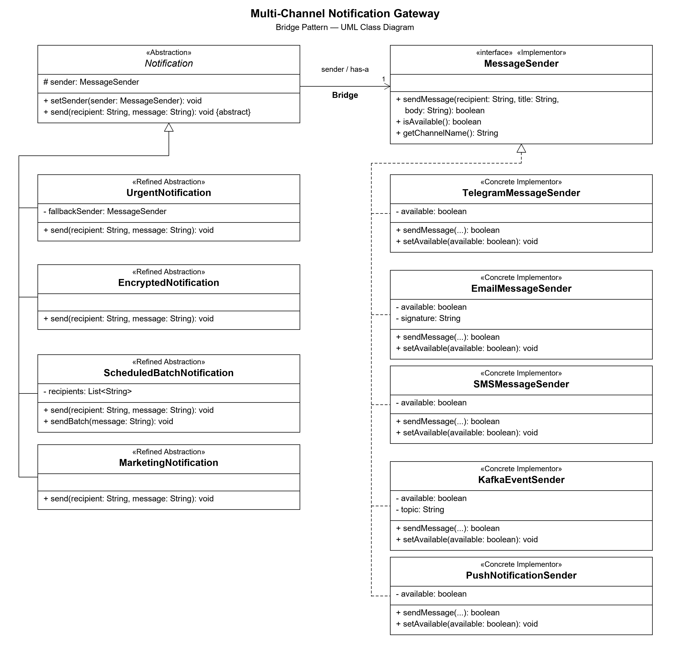

# Assignment 3 — Multi-Channel Notification Gateway

### 1. What are the two independent dimensions?
The two dimensions are notification types and delivery providers. For example, UrgentNotification is a notification type, and TelegramMessageSender is a delivery provider. We can change them independently.

### 2. Where exactly is the Bridge?
The Bridge is the MessageSender field inside Notification. Notification uses this interface to work with different providers. The setSender() method lets us change the provider at runtime.

### 3. Why is inheritance problematic here?
If we use only inheritance, we may need a separate class for every combination, like UrgentTelegramNotification and UrgentEmailNotification. With more types and providers, we get too many classes.

### 4. What happens when a new provider is added?
We create a new class that implements MessageSender. It can work with existing notification types without changing them.
PushNotificationSender is an example.

### 5. What happens when a new Notification type is added?
We create a new class that extends Notification and implements send(). It can use existing providers through MessageSender. MarketingNotification is an example.

### 6. Why is this Bridge rather than Adapter?
Bridge separates notification logic from delivery logic, so both can change independently. Adapter makes an existing class work with an interface that it does not support. Here, we designed the two parts to work together through MessageSender from the start.

## Independent Extension
We added PushNotificationSender by implementing MessageSender, without changing the existing notification classes.

We also added MarketingNotification by extending Notification, without changing the existing senders.

This shows the main benefit of the Bridge pattern: notification types and delivery providers can be developed separately. Any notification type can work with any provider that implements MessageSender.

## How to Run

1. Open the project in IntelliJ IDEA.
2. Select Java 17 or newer as the project SDK.
3. Run Main.java.

## Unit Tests

The project uses JUnit 5.

1. Add the JUnit 5 library if it is not connected.
2. Mark the test folder as Test Sources Root.
3. Run NotificationTest.

The tests check delivery, unavailable providers, fallback, SMS length, message encoding, batch delivery, runtime switching, Push notifications, and marketing notifications.

## UML Class Diagram

